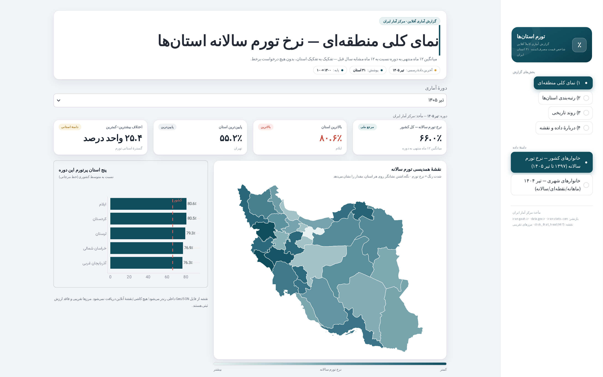

# Regional Inflation Report — Iran (پروژهٔ ۴: تورم استان‌های ایران)

**An offline-first, Persian/RTL report that maps official CPI inflation by province** — annual CPI inflation by province (۱۳۹۷–۱۴۰۴) plus two monthly snapshots (خرداد و تیر ۱۴۰۵), with internal GeoJSON rendering and **zero runtime network calls**.

فارسی: گزارش گرافیکی **کاملاً آفلاین** از نرخ تورم رسمی (مرکز آمار ایران) به تفکیک ۳۱ استان — نقشهٔ داخلی، بدون tile/CDN، با اعداد واقعی و انتساب کامل منابع.



## What's inside

- **Streamlit app** (`app.py`, 4 pages, FA/RTL, Vazirmatn embedded): regional overview map (SVG, internal projection) · province ranking · historical trend · data & attribution page. No tiles, no CDN, no telemetry (`.streamlit/config.toml` → `gatherUsageStats = false`).
- **Data** (`data/`): 31 provinces × 10 periods (310 rows) — annual inflation 2018–2025 + June/July 2026 monthly snapshots · supplementary Tir 1404 **urban** table (index, monthly/YoY/annual) · national reference series. Sources & licenses: [SOURCES.md](SOURCES.md).
- **Star model for Power BI** (`model/`, `report/`): `dim_period` + `dim_province` + facts, DAX measures, build guide for a custom Shape Map with the internal GeoJSON, and a manual offline checklist.
- **Quality gates**: 23 unittest controls (`tests/test_data_quality.py`), Streamlit AppTest for all 4 pages, live screenshots in `assets/`.

## Quickstart

```bash
pip install -r requirements.txt
streamlit run app.py
```

Then open the local URL. Everything renders locally — works on an air-gapped machine.

## Honesty notes (read before citing)

- Figures are **official statistics** (Statistical Center of Iran), transcribed from published tables (irangaah.ir documented to data.gov.ir; iranstatis.com preview, user-approved mirror). Independent cross-check against the canonical files is **pending** — see [VALIDATION.md](VALIDATION.md) and [LIMITATIONS.md](LIMITATIONS.md).
- Boundaries are approximate (3-decimal coordinates); not legal/cadastral; islands omitted. **Attribution is mandatory:** click_that_hood (MIT) — simplified; © OpenStreetMap contributors may apply (ODbL).
- No `.pbix` is shipped — build the Shape Map in Power BI Desktop via `report/POWER_BI_BUILD_GUIDE.md`.
- No sales/orders/tickets data; an earlier synthetic dataset was fully removed.

## Docs (Persian)

[README_FA.md](README_FA.md) — اجرا، ساختار پروژه، تست‌ها • [SOURCES.md](SOURCES.md) • [VALIDATION.md](VALIDATION.md) • [LIMITATIONS.md](LIMITATIONS.md) • [model/MODEL.md](model/MODEL.md) • [report/POWER_BI_BUILD_GUIDE.md](report/POWER_BI_BUILD_GUIDE.md)

## License

Code: **MIT** (see [LICENSE](LICENSE)). Data and boundaries keep their own licenses — see [SOURCES.md](SOURCES.md). Font: Vazirmatn (SIL OFL 1.1).
